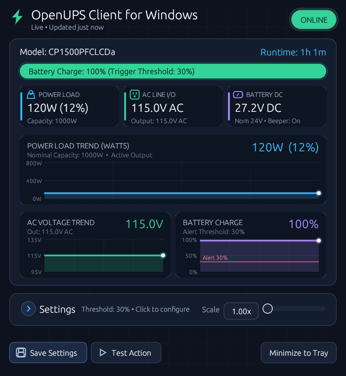

# OpenUPS Client for Windows

[](LICENSE)
[](https://github.com/virlatinus/UPS-Client-Windows)
[](https://www.rust-lang.org/)

> **Modern Windows App that monitors any compatible UPS endpoint via HTTP and triggers alerts or actions on specific events**

**OpenUPS Client for Windows** is a lightweight, native Rust application for Windows 10 and Windows 11 that continuously monitors an HTTP/JSON UPS status endpoint in the background from the Windows System Tray and executes configurable actions when battery charge drops to or below your chosen threshold.



---

## ✨ Key Features

- **System Tray First**:
  - Runs unobtrusively in the Windows System Tray with dynamic status icon coloring (**Emerald** = Online, **Amber** = On Battery, **Red** = Low Battery / Alert, **Slate** = Connection Error) and live telemetry tooltips.
  - **Double-click** the System Tray icon at any time to open the modern settings and telemetry window.
  - **Right-click** the System Tray icon for the context menu:
    - `Show interface`
    - `Quit`
  - Closing the window (`[X]`) minimizes the app back to the System Tray without interrupting background monitoring.
- **Modern Fluent-Inspired Interface (`eframe` / `egui`)**:
  - Real-time UPS telemetry header displaying model name, online/battery status badge, battery charge progress bar, estimated runtime, load percentage/wattage, AC input/output voltage, and battery voltage.
- **Basic Settings**:
  1. **Run on Windows startup**: Automatically registers/unregisters `UPS-Client-Windows` in `HKCU\Software\Microsoft\Windows\CurrentVersion\Run` (launching with `--minimized` directly into the System Tray).
  2. **UPS Status URL**: Configurable HTTP/HTTPS endpoint to poll (defaults to `http://192.168.2.161:8000/api/ups`), complete with an instant **Poll Now** button.
  3. **Threshold in 10% increments**: Selectable trigger threshold from `10%` to `100%` (`10%`, `20%`, `30%`, `40%`, `50%`, `60%`, `70%`, `80%`, `90%`, `100%`).
  4. **Action to perform**:
     - **a. Alert with native Windows notification**: Sends a native Windows 10/11 Toast notification summarizing battery status and remaining runtime.
     - **b. Play a sound**: Plays a native Windows system warning alert and audible tone sequence.
     - **c. Graceful shutdown**: Initiates a graceful Windows shutdown (`shutdown /s /t 30 /c "..."`).
     - **d. Execute command**: Prompts for a custom command or script to execute and injects live UPS telemetry as environment variables.

---

## 📡 Expected UPS Status JSON Format

The monitored UPS HTTP endpoint should return `application/json` matching the following structure:

```json
{
  "online": true,
  "model": "CP1500PFCLCDa",
  "status": "OL",
  "status_label": "ONLINE",
  "on_battery": false,
  "low_battery": false,
  "charging": false,
  "discharging": false,
  "should_shutdown": false,
  "battery_charge": 100,
  "battery_charge_low": 10,
  "battery_charge_warning": 20,
  "battery_runtime": 3350,
  "battery_runtime_min": 56,
  "battery_runtime_low": 300,
  "battery_voltage": 27.1,
  "battery_voltage_nominal": 24.0,
  "input_voltage": 113.0,
  "output_voltage": 113.0,
  "load": 15,
  "realpower_nominal": 1000,
  "output_watts": 150,
  "beeper": "enabled"
}
```

### Environment Variables Passed to Custom Commands

When **Execute command** (`4d`) is selected, the following environment variables are automatically populated for the spawned command:

| Variable | Example Value | Description |
| :--- | :--- | :--- |
| `UPS_MODEL` | `CP1500PFCLCDa` | UPS model identifier |
| `UPS_STATUS` | `OL` | Short UPS status code |
| `UPS_STATUS_LABEL` | `ONLINE` | Human-readable status label |
| `UPS_BATTERY_CHARGE` | `100` | Battery charge percentage (`0`–`100`) |
| `UPS_BATTERY_RUNTIME` | `3350` | Estimated runtime remaining in seconds |
| `UPS_ON_BATTERY` | `false` | Whether the UPS is currently running on battery |
| `UPS_LOAD` | `15` | Current load percentage |
| `UPS_OUTPUT_WATTS` | `150` | Current real power output in Watts |

---

## 🛠️ Building From Source

### Prerequisites

- **Windows 10 or Windows 11**
- **[Rust Toolchain](https://rustup.rs/)** (`rustup` + `cargo`, stable channel with MSVC target `x86_64-pc-windows-msvc`)

### Build & Run

```powershell
# Clone the repository
git clone https://github.com/virlatinus/UPS-Client-Windows.git
cd UPS-Client-Windows

# Run in development mode
cargo run

# Launch directly minimized to the System Tray
cargo run -- --minimized

# Build optimized release executable
cargo build --release
```

The compiled binary will be located at `target\release\ups-client-windows.exe`.

### Running Tests

```powershell
cargo test
```

---

## 📦 Building Windows Installers (`.exe` & `.msi`) Locally

This repository uses two standard open-source Windows installer toolchains:
1. **[NSIS (Nullsoft Scriptable Install System)](https://nsis.sourceforge.io/)** — generates the `.exe` setup installer (`UPS-Client-Windows-v1.0.0-x86_64-setup.exe`).
2. **[WiX Toolset v3](https://wixtoolset.org/)** (and compatible with **[cargo-wix](https://github.com/volks73/cargo-wix)**) — generates the Windows Installer `.msi` package (`UPS-Client-Windows-v1.0.0-x86_64.msi`).

### 1. Install Open-Source Installer Tools

You can install NSIS and the WiX Toolset locally using `winget` (or Chocolatey):

```powershell
# Install NSIS (for .exe installer)
winget install NSIS.NSIS

# Install WiX Toolset v3 (for .msi installer)
winget install WiXToolset.WiXToolset

# (Optional) Install cargo-wix Cargo subcommand
cargo install cargo-wix
```

### 2. Build All Installers with One Script

Run the bundled PowerShell build script from the repository root:

```powershell
# Build release binary, NSIS .exe installer, WiX .msi installer, and SHA256SUMS.txt
.\installer\build-installers.ps1 -Version "v1.0.0"
```

All generated files are placed in the `dist\` directory:
- `dist\ups-client-windows-v1.0.0-x86_64.exe` (Standalone portable binary)
- `dist\UPS-Client-Windows-v1.0.0-x86_64-setup.exe` (NSIS `.exe` installer with Start Menu/Desktop shortcuts & uninstaller)
- `dist\UPS-Client-Windows-v1.0.0-x86_64.msi` (WiX `.msi` Windows Installer package)
- `dist\SHA256SUMS.txt` (SHA-256 checksums)

### 3. Manual / Individual Installer Commands

If you prefer to build either installer individually:

```powershell
# 1. Compile the release binary first
cargo build --release

# 2a. Build only the NSIS .exe installer
makensis /DVERSION=1.0.0 /DOUTFILE=dist\UPS-Client-Windows-v1.0.0-x86_64-setup.exe installer\ups-client-windows.nsi

# 2b. Build only the WiX .msi installer (using WiX candle + light)
candle -dVersion=1.0.0 -dTargetBin=target\release\ups-client-windows.exe -arch x64 -out dist\main.wixobj wix\main.wxs
light -ext WixUIExtension -spdb -out dist\UPS-Client-Windows-v1.0.0-x86_64.msi dist\main.wixobj

# Or using cargo-wix:
cargo wix --nocapture --version 1.0.0 --output dist\UPS-Client-Windows-v1.0.0-x86_64.msi
```

---

## 🚀 Automated GitHub Release Workflow (`v1.0.0` Format)

The GitHub Actions workflow in [`.github/workflows/release.yml`](.github/workflows/release.yml) automatically builds and attaches the standalone binary, `.exe` setup installer, `.msi` installer, and `SHA256SUMS.txt` whenever a new version tag in `vX.Y.Z` format (such as `v1.0.0`) is pushed or a GitHub Release is published:

```powershell
git tag v1.0.0
git push origin v1.0.0
```

You can also trigger the workflow manually at any time from the **Actions → Release & Build Installers → Run workflow** tab on GitHub.

---

## 📂 Configuration Storage

User settings are persisted automatically as JSON at:

```text
%APPDATA%\virlatinus\UPS-Client-Windows\config\config.json
```

---

## 📄 License

This project is licensed under the [MIT License](LICENSE).
